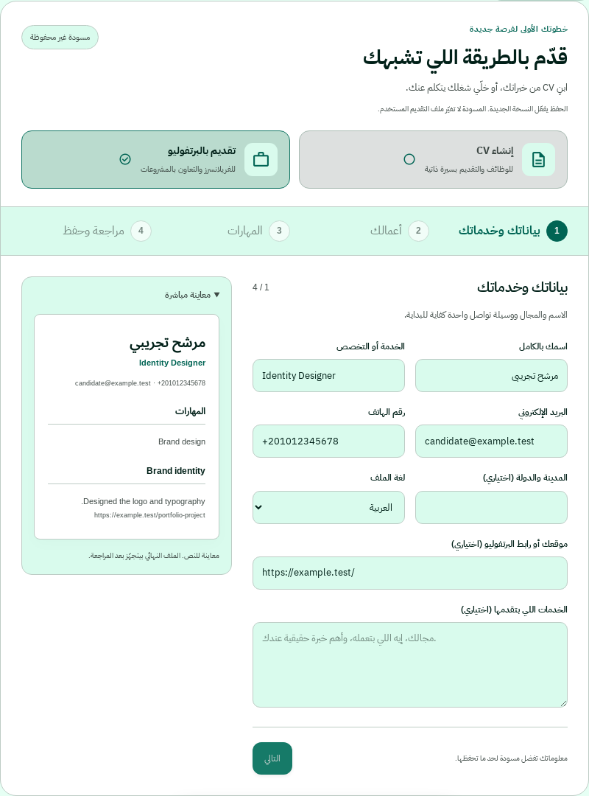
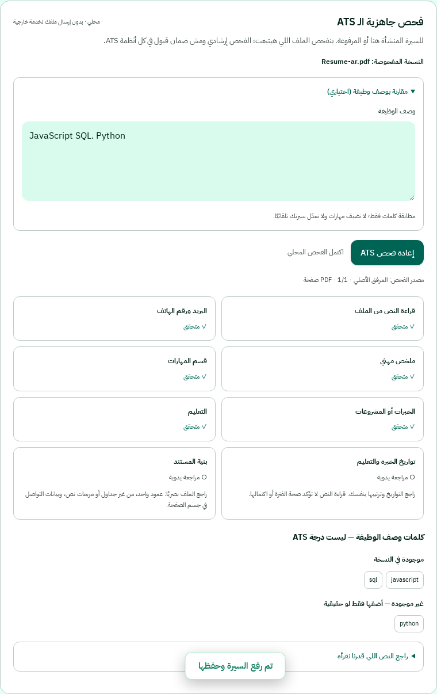
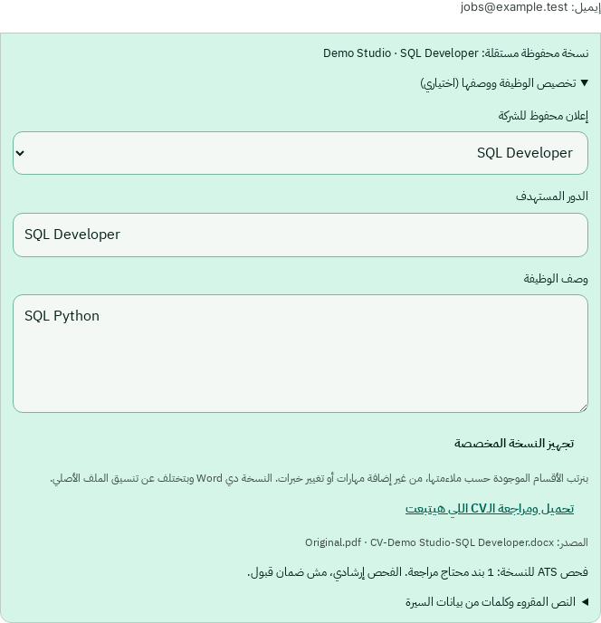

# CV builder and portfolio applications

Open **CV / Portfolio** in the workspace sidebar (or Settings → CV).

- Build a CV in four steps: contact details, experience and education, skills and projects, then review and save. Experience is optional for entry-level applicants. All content comes from entered facts; no credentials or achievements are invented.
- Download the generated **DOCX** from the saved version. Arabic and English documents use a single column, actual text and conventional section headings; no photos, tables, text boxes, headers or footers carry applicant information.
- The ATS panel checks completeness and the generated layout. Optional job-description comparison reports literal word overlap. These are local advisory checks, **not tests against ATS vendors, an ATS ranking, a guarantee of successful parsing, or a hiring guarantee**. Follow each employer's requested file format and verify any parsed application fields.
- Choose **Apply with a portfolio**, describe your service and add at least one project with its actual contribution and a public HTTP(S) link. Saving selects that profile for applications. Generation uses portfolio facts and retains every project link, including with fixed templates. No CV is attached in this mode.
- Every save creates a separate version. Use a saved version to switch modes. Edit a copy to update structured profiles; changing their plain-text representation is blocked to keep the exported document consistent.
- Review and approve messages as usual. Nothing is automatically sent by creating a profile.

## Persistence and delivery

The idempotent launch migration adds `kind` and `document_json` to `cv_profiles`; existing rows keep `kind=cv`. The active version remains `users.active_cv_id`, so existing campaigns and scheduled sends retain their original immutable `cv_id` rather than following later mode changes. Limits and storage accounting include structured data. New documents are rendered on download/delivery, with no remote URL fetching.

Shared delivery resolves the pinned version: uploaded PDF, generated DOCX, portfolio with no attachment, or legacy text-only CV. Gmail MIME and both regular WhatsApp providers preserve the actual document MIME type. The separate PDF-only OpenWA trial remains PDF-only.

## Validation

```sh
npm ci
npm run check
npm test
```

`tests/profile-builder.test.cjs` covers validation, owner isolation, reviewed-content fingerprints, real DOCX contents, mode selection, immutable versions, MIME typing and delivery on both channels. Existing scheduler and campaign tests cover pinned `cv_id` delivery. `tests/browser/profile-builder.cjs` exercises the actual CV router with a temporary PostgreSQL-compatible database, Arabic/English creation, download and portfolio switching at mobile and desktop sizes. It requires Playwright and an installed Chromium; set `PLAYWRIGHT_CHROMIUM_EXECUTABLE` and optional JSON `PLAYWRIGHT_LAUNCH_ARGS` for the environment.

## Rollout

Deploy the feature branch separately for review before rolling it out to users. The normal startup applies the additive migration. No production account, credential, database or deployment configuration is changed by the implementation or tests. Rolling back the application leaves old CVs intact; keep new profile rows until the newer application is restored, since older code does not recognize their types.

## Profile workspace UX

The editor has four guarded steps, inline validation with focus on the first error, an updating text preview, independent drafts for CV and portfolio modes, and undo for removed entries. Empty optional entries are omitted; a portfolio requires a linked work sample. Saving explicitly selects a new version; switching editor modes does not switch the currently selected saved version. Unsaved edits remain in memory when changing steps, modes, language or settings, with a browser warning before leaving. Drafts are not persisted across a page reload.

Existing PDF/DOCX/TXT uploads and manual text entry are separate expandable sections. Generated documents and portfolios are edited as copies so the saved export and application facts stay consistent.

For an isolated local review with sample data and simulated sending providers:

```sh
npm ci
npm run trial:profiles
```

Open `http://127.0.0.1:4176/app`. This loopback-only harness uses a temporary in-memory database, a fixed demo user and fake AI/sending providers. It never authenticates to or sends messages through production services; do not use it with real personal data. Restarting it clears the sample database.

The integrated browser suite runs the real workspace HTML/scripts and real CV, writing, sending, scheduling and campaign routes against that harness. It covers invalid inputs, keyboard activation, focus, field limits, disabled current-job end dates, optional blank rows, deletion undo, network failures and retries, duplicate save prevention, Word download and text inspection, separate application modes, version selection/editing, AR/EN switching, dark/light themes, and widths of 320, 360, 390, 768, 1024, 1366 and 1920 pixels. Delivery assertions use the local captured provider, not live Gmail or WhatsApp.

Preview from the integrated local QA flow (sample data):



## ATS checks for every saved CV

A shared `POST /api/cv/ats` endpoint inspects the owner-selected immutable CV version. It works for generated CVs and uploaded PDF, Word DOCX and TXT files. New uploads automatically show the ATS panel; each saved CV also has a Check ATS action that does not select it for sending. Portfolio mode is excluded.

Generated CVs are actually rendered and read back as DOCX; uploaded attachments are parsed from their original bytes, rather than trusting edited saved text. The panel explicitly warns when the saved text differs. PDF layout and uploaded date correctness remain manual-review items. DOCX checks inspect table/column/text-box/image/header/footer markers; those checks do not certify a full visual layout. Job comparison uses normalised literal tokens, including technical terms and Arabic characters, with no vendor ATS score or acceptance guarantee.

The PDF reader uses a copied Uint8Array to avoid Buffer/xref failures in the legacy parser. Parsing is bounded to 20 pages and 200,000 text characters. Partial or textless pages cannot pass the text check; new partial/unreadable uploads retain the previous active version. DOCX XML is bounded while streaming, external entities/macros/embedded binary parts are rejected, and no external document links are fetched. Per-account concurrent ATS requests are limited. Reports are authenticated and marked private/no-store.

New DOCX attachments use additive attachment-data/MIME columns; old PDFs stay in the existing PDF column. Original Word bytes and filenames are retained for downloads and both sending channels, including when saved text is edited. Storage limits count attachment bytes.

`tests/cv-ats.test.cjs` exercises real PDF/DOCX parsing, Arabic/English round trips, scanned/partial/corrupt/oversized input, source mismatch, keyword boundaries, owner isolation, and preserving old data on failure. `tests/browser/cv-ats.cjs` runs PDF upload, generated CV checking, Word reupload, older-version checks, original text review, job comparison, failure/retry and mobile AR/EN flows through the real workspace/router fixture.

ATS panel from the integrated upload flow (sample data):



## Company and job-specific CV attachments

The message preview and new campaign review prepare a separate, immutable Word CV per company. Start from a platform-generated CV or an original PDF/DOCX/TXT attachment. New previews automatically select a single saved job when unambiguous; reviewed campaign copies keep their original target. Select a saved job belonging to that company, or enter a target role and job description. Without a description the UI explicitly labels company/role-only tailoring. The same target accompanies message generation; fixed-template role variables also use it.

Tailoring is deterministic and facts-only: identify the application target and prioritise whole existing sections by literal keyword relevance. All extracted source content remains; employment dates stay with their employer. No missing skills, experience or achievements are invented. The candidate name stays first; the application target is identified separately and is excluded from candidate keyword matching. The Word copy uses a new single-column layout and must be reviewed; original PDF formatting is not preserved. Scanned/partially readable sources are rejected. The generated bytes are read back and receive the shared advisory ATS checks, never a vendor score or guarantee.

A tailored CV is a `cv_profiles` row with `kind=tailored`, original generated attachment bytes and `tailoring_json` provenance. A unique source/company/role/job/content key reuses the same copy. Creation never changes `active_cv_id`; derived copies are hidden from the ordinary source version list and do not consume the source-version count, but their bytes and metadata count toward storage. A user-approved source fact summary can be reused after section reordering; employer targeting stays separate from candidate facts. Different companies cannot exchange copies. The download link and provider receive the same stored bytes and DOCX MIME, with a company-specific filename sent to the provider.

New browser immediate sends pass `tailor=true` and require a reviewed company copy (or portfolio). Scheduled sends pin its existing `cv_id`. New browser campaigns pass `tailorCv=true`, pin their source, require a valid per-company copy at generation/approval, and save it in `campaign_items.cv_id`. The worker sends the item CV rather than replacing it with the campaign's base CV. Delivery stores the actual CV ID in `email_log`. Existing API callers and previously approved schedules/campaigns retain their older attachment behavior; they are not silently rewritten. Portfolio mode remains links with no CV attachment.

Changing targeting invalidates the UI approval until preparing again; editing safety cancels pending sending schedules. Deleting a source deletes its unused derived copies. A pending/uncertain scheduled send or active campaign blocks deletion of its reviewed copy and source. Additive migrations provide the new metadata and pinned item/log fields; they do not change existing rows or active selections.

The tour, help search and chatbot read the same bilingual `tailored-cv` guide. The client limits simultaneous preparations to two and keeps errors retryable.

Validation: `tests/cv-tailor.test.cjs` exercises real documents/database/routes, owner/job/source isolation, original facts, duplicate reuse, ATS output, immutable copies, original-source selection, byte-identical email/WhatsApp delivery, schedule and campaign pinning, generated/uploaded Word/TXT, portfolio exclusion, unreadable input and shared help knowledge. `tests/browser/cv-tailor.cjs` checks real preview/target selection, downloading and sending exact bytes, campaign approval, AR/EN and mobile. All sends use isolated fake providers; no production messages are sent.


