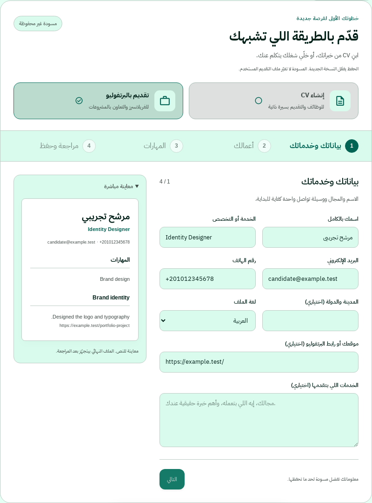

# CV builder and portfolio applications

Open **CV / Portfolio** in the workspace sidebar (or Settings → CV).

- Build a CV in four steps: contact details, experience and education, skills and projects, then review and save. Experience is optional for entry-level applicants. All content comes from entered facts; no credentials or achievements are invented.
- Download the generated **DOCX** from the saved version. Arabic and English documents use a single column, actual text and conventional section headings; no photos, tables, text boxes, headers or footers carry applicant information.
- The ATS panel checks completeness and the generated layout. Optional job-description comparison reports literal word overlap. These are local advisory checks, **not tests against ATS vendors, an ATS ranking, a guarantee of successful parsing, or a hiring guarantee**. Follow each employer's requested file format and verify any parsed application fields.
- Choose **Apply with a portfolio**, describe your service and add at least one project with its actual contribution and a public HTTP(S) link. Saving selects that profile for applications. Generation uses portfolio facts and retains every project link, including with fixed templates. No CV is attached in this mode.
- Every save creates a separate version. Use a saved version to switch modes. Edit a copy to update structured profiles; changing their plain-text representation is blocked to keep the exported document consistent.
- Review and approve messages as usual. Nothing is automatically sent by creating a profile.

## Persistence and delivery

The idempotent launch migration adds `kind` and `document_json` to `cv_profiles`; existing rows keep `kind=cv`. The active version remains `users.active_cv_id`, so existing campaigns and scheduled sends retain their original immutable `cv_id` rather than following later mode changes. Limits and storage accounting include structured data. New documents are rendered on download/delivery, with no remote URL fetching.

Shared delivery resolves the pinned version: uploaded PDF, generated DOCX, portfolio with no attachment, or legacy text-only CV. Gmail MIME and both regular WhatsApp providers preserve the actual document MIME type. The separate PDF-only OpenWA trial remains PDF-only.

## Validation

```sh
npm ci
npm run check
npm test
```

`tests/profile-builder.test.cjs` covers validation, owner isolation, reviewed-content fingerprints, real DOCX contents, mode selection, immutable versions, MIME typing and delivery on both channels. Existing scheduler and campaign tests cover pinned `cv_id` delivery. `tests/browser/profile-builder.cjs` exercises the actual CV router with a temporary PostgreSQL-compatible database, Arabic/English creation, download and portfolio switching at mobile and desktop sizes. It requires Playwright and an installed Chromium; set `PLAYWRIGHT_CHROMIUM_EXECUTABLE` and optional JSON `PLAYWRIGHT_LAUNCH_ARGS` for the environment.

## Rollout

Deploy the feature branch separately for review before rolling it out to users. The normal startup applies the additive migration. No production account, credential, database or deployment configuration is changed by the implementation or tests. Rolling back the application leaves old CVs intact; keep new profile rows until the newer application is restored, since older code does not recognize their types.

## Profile workspace UX

The editor has four guarded steps, inline validation with focus on the first error, an updating text preview, independent drafts for CV and portfolio modes, and undo for removed entries. Empty optional entries are omitted; a portfolio requires a linked work sample. Saving explicitly selects a new version; switching editor modes does not switch the currently selected saved version. Unsaved edits remain in memory when changing steps, modes, language or settings, with a browser warning before leaving. Drafts are not persisted across a page reload.

Existing PDF/TXT uploads and manual text entry are separate expandable sections. Generated documents and portfolios are edited as copies so the saved export and application facts stay consistent.

For an isolated local review with sample data and simulated sending providers:

```sh
npm ci
npm run trial:profiles
```

Open `http://127.0.0.1:4176/app`. This loopback-only harness uses a temporary in-memory database, a fixed demo user and fake AI/sending providers. It never authenticates to or sends messages through production services; do not use it with real personal data. Restarting it clears the sample database.

The integrated browser suite runs the real workspace HTML/scripts and real CV, writing, sending, scheduling and campaign routes against that harness. It covers invalid inputs, keyboard activation, focus, field limits, disabled current-job end dates, optional blank rows, deletion undo, network failures and retries, duplicate save prevention, Word download and text inspection, separate application modes, version selection/editing, AR/EN switching, dark/light themes, and widths of 320, 360, 390, 768, 1024, 1366 and 1920 pixels. Delivery assertions use the local captured provider, not live Gmail or WhatsApp.

Preview from the integrated local QA flow (sample data):


